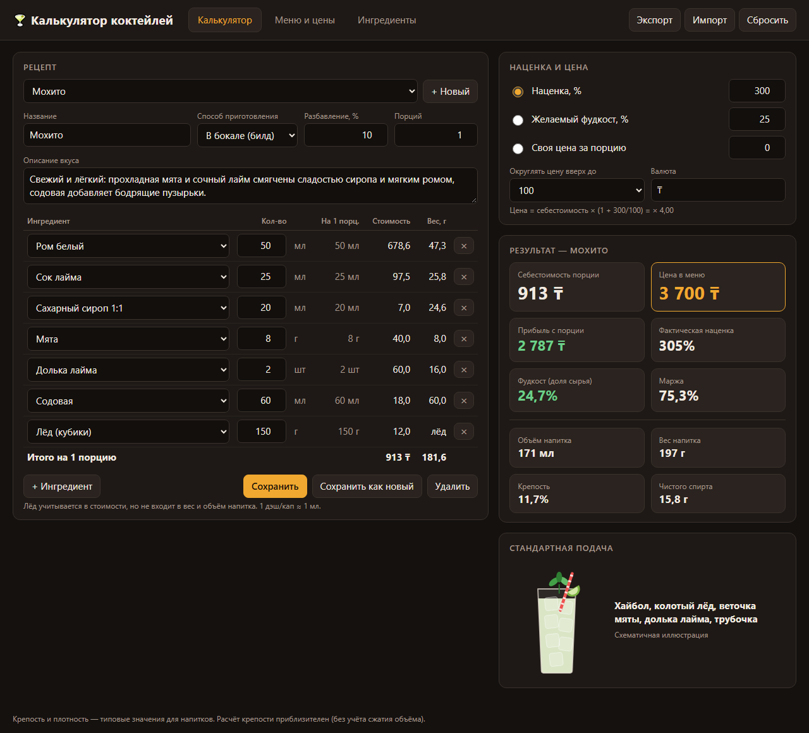
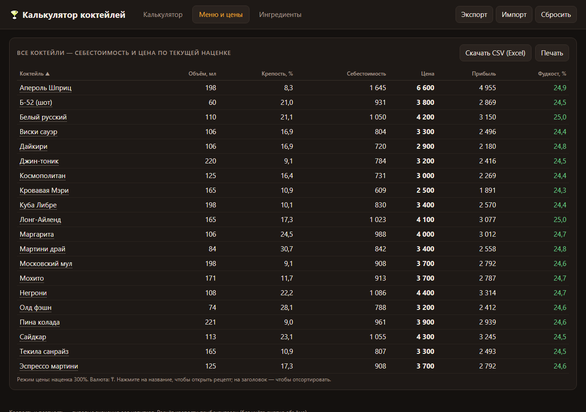
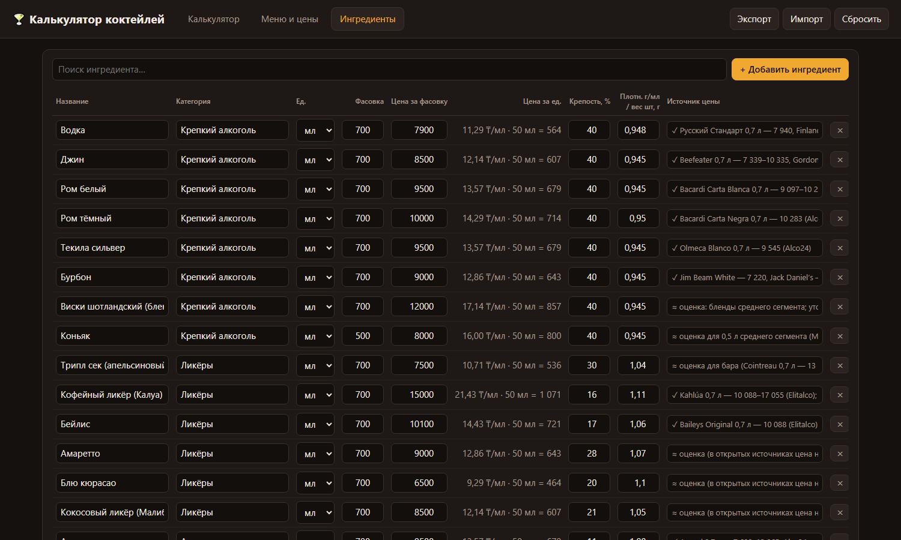

# 🍸 Калькулятор себестоимости коктейлей

Программа для работников бара: считает себестоимость коктейля по составу и граммовке, добавляет наценку и показывает цену в меню, прибыль, фудкост, объём, вес и крепость напитка. Цены в базе — **розница Алматы, средний сегмент, в тенге (₸)**.

Работает как калькулятор: выбираете коктейль (или собираете свой), меняете количество ингредиентов — результат пересчитывается сразу.

## Запуск

Инструмент лежит в папке [`tools/`](tools/); там же [первый промпт (ТЗ), финальный промпт и скриншот](tools/README.md).

**Онлайн (в любом браузере, в том числе на телефоне):** https://cheshirico.github.io/cocktail_costcalculator/

**Офлайн:** установка не нужна. Скачайте [`tools/cocktail_calculator.html`](tools/cocktail_calculator.html) и откройте двойным щелчком в любом браузере (Chrome, Edge, Firefox). Интернет не требуется.

Прямые ссылки на вкладки: добавьте к адресу `#menu` («Меню и цены») или `#ing` («Ингредиенты»).

Данные (цены, свои рецепты, настройки) сохраняются в браузере. Для переноса на другой компьютер — кнопки **Экспорт** / **Импорт** (файл JSON). **Сбросить** возвращает исходную базу.

## Возможности

**Вкладка «Калькулятор»**
- 20 готовых классических коктейлей (пропорции IBA) и возможность собрать свой.
- Для каждого ингредиента: количество, расход на N порций, стоимость и вес.
- Итог: себестоимость порции, цена в меню, прибыль, фактическая наценка, фудкост, маржа.
- Объём напитка (с учётом разбавления), вес, крепость, граммы чистого спирта.
- Расчёт партии: себестоимость, выручка и прибыль на N порций.

**Вкладка «Меню и цены»**
- Все коктейли в одной таблице, сортировка по любой колонке, экспорт в CSV (Excel), печать.

**Вкладка «Ингредиенты»**
- База из 44 позиций: крепкие напитки, ликёры, аперитивы и вермуты, игристое, соки и сиропы, газировки, лёд и гарнир.
- Для каждой: фасовка, цена, крепость, плотность (для веса) или вес штуки, источник цены. Позиции можно добавлять, менять и удалять.

**Три способа назначить цену**
1. Наценка в процентах от себестоимости (по умолчанию 300%): `цена = себестоимость × (1 + наценка/100)`.
2. Желаемый фудкост: `цена = себестоимость ÷ фудкост`.
3. Своя цена вручную.

Цену можно округлять вверх до 1, 5, 10, 50, 100 или 500 ₸ (по умолчанию 100 ₸).

## Формулы

| Величина | Формула |
|---|---|
| Стоимость ингредиента | `количество × цена фасовки ÷ размер фасовки` |
| Вес ингредиента | мл × плотность; г — как есть; шт × вес штуки |
| Объём напитка | сумма жидкостей × (1 + разбавление/100) |
| Крепость | `мл спирта ÷ объём напитка × 100`, где спирт = мл × крепость ингредиента |
| Чистый спирт, г | мл спирта × 0,789 |
| Фудкост | `себестоимость ÷ цена × 100` |

Лёд входит в стоимость, но не входит в вес и объём напитка. Разбавление льдом задаётся по способу приготовления (шейк 25%, стир 20%, билд 10%, блендер 30%, слоями 0%) и редактируется.

## Результаты: цены ингредиентов (Алматы, ₸)

Отметка **✓** — цена найдена в алматинских магазинах (разброс между магазинами и датами большой, часть цен акционная; брались значения ближе к середине диапазона). **≈** — оценка, цену в открытых источниках найти не удалось.

### Подтверждено ценами магазинов

| Позиция | Фасовка | Цена в базе | Что найдено |
|---|---|---|---|
| Водка | 0,7 л | 7 900 | Русский Стандарт 7 940, Finlandia 9 030 |
| Джин | 0,7 л | 8 500 | Beefeater 7 339–10 335, Gordon's 7 632 |
| Ром белый | 0,7 л | 9 500 | Bacardi Carta Blanca 9 097–10 283 |
| Ром тёмный | 0,7 л | 10 000 | Bacardi Carta Negra 10 283 |
| Текила сильвер | 0,7 л | 9 500 | Olmeca Blanco 9 545 |
| Бурбон | 0,7 л | 9 000 | Jim Beam White 7 220, Jack Daniel's 11 050 (взята середина) |
| Апероль | 0,7 л | 9 500 | 7 688–12 065 |
| Кампари | 0,7 л | 11 300 | 10 011–14 365 |
| Бейлис | 0,7 л | 10 100 | Baileys Original 10 088 |
| Кофейный ликёр (Калуа) | 0,7 л | 15 000 | Kahlúa 10 088–17 055 (взят верх диапазона) |
| Вермут красный (Россо) | 1 л | 6 500 | Martini Rosso 6 499 |
| Кола | 1 л | 589 | Coca-Cola 589 (Wolt) |
| Сок лимона | 1 л | 1 700 | Liotti натуральный 1 700 |
| Сок лайма | 1 л | 3 900 | аналог: RC сироп «лимонный сок» 3 930 |

### Оценки (≈) — рекомендуется уточнить у поставщика

| Позиция | Фасовка | Цена в базе |
|---|---|---|
| Виски шотландский (бленд) | 0,7 л | 12 000 |
| Коньяк | 0,5 л | 8 000 |
| Трипл сек | 0,7 л | 7 500 |
| Амаретто | 0,7 л | 9 000 |
| Блю кюрасао | 0,7 л | 6 500 |
| Малибу | 0,7 л | 8 500 |
| Вермут сухой | 1 л | 6 500 |
| Просекко | 0,75 л | 6 500 |
| Ангостура биттер | 0,2 л | 10 000 |
| Апельсиновый сок | 1 л | 800 |
| Клюквенный сок | 1 л | 1 800 |
| Ананасовый сок | 1 л | 900 |
| Томатный сок | 1 л | 700 |
| Сахарный сироп 1:1 | 1 л | 350 |
| Гренадин | 1 л | 5 500 |
| Кокосовый крем | 1 л | 4 500 |
| Сливки 20% | 1 л | 1 500 |
| Эспрессо (порция 30 мл ≈ 120 ₸) | 1 л | 4 000 |
| Содовая | 1 л | 300 |
| Тоник | 1 л | 900 |
| Имбирное пиво | 1 л | 2 500 |
| Лёд | 1 кг | 80 |
| Мята | 100 г | 500 |
| Соль для ободка | 1 кг | 300 |
| Яичный белок | 1 шт | 90 |
| Долька лайма / лимона / апельсина | 1 шт | 30 / 25 / 30 |
| Оливка / вишня коктейльная | 1 шт | 40 / 50 |

## Результаты: себестоимость и цена коктейлей

Расчёт по ценам выше, наценка 300%, округление цены вверх до 100 ₸.

| Коктейль | Объём, мл | Крепость, % | Себестоимость, ₸ | Цена, ₸ | Прибыль, ₸ | Фудкост, % |
|---|---:|---:|---:|---:|---:|---:|
| Апероль Шприц | 198 | 8,3 | 1 645 | 6 600 | 4 955 | 24,9 |
| Б-52 (шот) | 60 | 21,0 | 931 | 3 800 | 2 869 | 24,5 |
| Белый русский | 110 | 21,1 | 1 050 | 4 200 | 3 150 | 25,0 |
| Виски сауэр | 106 | 16,9 | 804 | 3 300 | 2 496 | 24,4 |
| Дайкири | 106 | 16,9 | 720 | 2 900 | 2 180 | 24,8 |
| Джин-тоник | 220 | 9,1 | 784 | 3 200 | 2 416 | 24,5 |
| Космополитан | 125 | 16,4 | 731 | 3 000 | 2 269 | 24,4 |
| Кровавая Мэри | 165 | 10,9 | 609 | 2 500 | 1 891 | 24,3 |
| Куба Либре | 198 | 10,1 | 830 | 3 400 | 2 570 | 24,4 |
| Лонг-Айленд | 165 | 17,3 | 1 023 | 4 100 | 3 077 | 25,0 |
| Маргарита | 106 | 24,5 | 988 | 4 000 | 3 012 | 24,7 |
| Мартини драй | 84 | 30,7 | 842 | 3 400 | 2 558 | 24,8 |
| Московский мул | 198 | 9,1 | 908 | 3 700 | 2 792 | 24,6 |
| Мохито | 171 | 11,7 | 913 | 3 700 | 2 787 | 24,7 |
| Негрони | 108 | 22,2 | 1 086 | 4 400 | 3 314 | 24,7 |
| Олд фэшн | 74 | 28,1 | 788 | 3 200 | 2 412 | 24,6 |
| Пина колада | 221 | 9,0 | 961 | 3 900 | 2 939 | 24,6 |
| Сайдкар | 113 | 23,1 | 1 055 | 4 300 | 3 245 | 24,5 |
| Текила санрайз | 165 | 10,9 | 807 | 3 300 | 2 493 | 24,5 |
| Эспрессо мартини | 125 | 17,3 | 908 | 3 700 | 2 792 | 24,6 |

## Как проверить, что расчёт верен

Откройте «Джин-тоник» с исходными ценами и сверьте с ручным счётом:

| Ингредиент | Расчёт | ₸ |
|---|---|---:|
| Джин 50 мл | 50 × 8 500 ÷ 700 | 607,14 |
| Тоник 150 мл | 150 × 900 ÷ 1 000 | 135,00 |
| Долька лайма | 1 шт | 30,00 |
| Лёд 150 г | 150 × 80 ÷ 1 000 | 12,00 |
| **Итого** | | **784,14** |

Цена: 784,14 × 4 = 3 136,57 → округление вверх до 100 → **3 200 ₸**. Объём: 200 мл + 10% разбавления = 220 мл. Крепость: 20 мл спирта ÷ 220 мл = 9,1%.

Дополнительно: измените цену водки на вкладке «Ингредиенты» — себестоимость водочных коктейлей должна пересчитаться; введите «Порций: 10» — колонка «На 10 порц.» должна показать 500 мл джина.

## Ограничения

- Цены в базе розничные: бары закупают у дистрибьюторов дешевле, поэтому реальная себестоимость обычно ниже. Впишите свои закупочные цены — все расчёты обновятся.
- Цены в интернет-магазинах быстро меняются, часть страниц содержит устаревшие или акционные цены. Перед использованием в бизнесе сверьте их.
- Крепость и вес приблизительные: не учитывается сжатие объёма при смешивании, разбавление льдом задаётся усреднённо.
- Граммовки — классические (IBA); у вашего бара они могут отличаться, их можно править в рецепте.

## Источники цен

- [AlmaWine — водка](https://almawine.kz/catalog/krepkiy_alkogol/vodka/)
- [Alco24 — крепкие напитки](https://alco24.kz/c/krepkie-napitki/)
- [Alco24 — аперитивы](https://alco24.kz/c/aperitiv/)
- [Elitalco — Beefeater](https://elitalco.kz/ru/catalog/beefeater-gin-47-07l_81)
- [Elitalco — ликёры](https://newelitalco.kz/ru/catalog/liqueur/)
- [Luxalco — американский виски](https://luxalco.kz/product-category/viski/kupazhirovannyj-viski/amerikanskij-viski/)
- [Wolt Алматы](https://wolt.com/ru/kaz/almaty/venue/smallala50)
- [Satu.kz](https://satu.kz/Sok-1-l.html)
