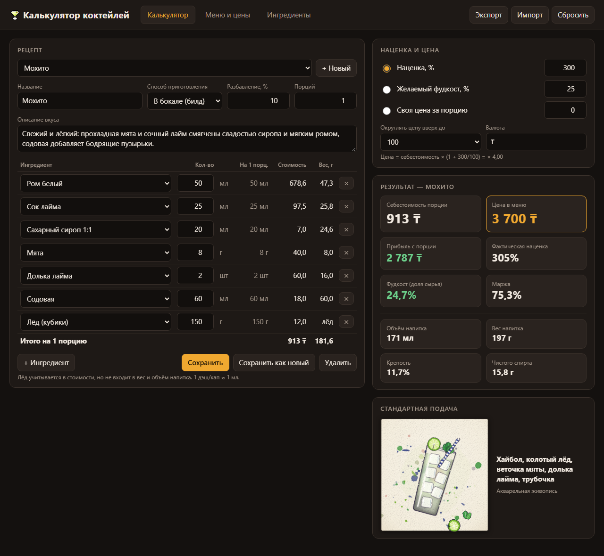

# 🍸 Калькулятор себестоимости коктейлей — инструмент и промпты

В этой папке лежит готовый инструмент и история его создания: **первый промпт (ТЗ)**, **финальный промпт**, который воспроизводит инструмент целиком, и скриншот результата.

| Файл | Что это |
|---|---|
| [`cocktail_calculator.html`](cocktail_calculator.html) | сам инструмент, один файл без зависимостей |
| [`screenshot-calculator.png`](screenshot-calculator.png) | скриншот инструмента |
| `README.md` | этот файл |

**Открыть онлайн:** https://cheshirico.github.io/cocktail_costcalculator/tools/cocktail_calculator.html
**Офлайн:** скачайте `cocktail_calculator.html` и откройте двойным щелчком в браузере.

## Скриншот инструмента



Слева рецепт (состав, граммовка, стоимость, вес и описание вкуса), справа наценка и цена, итоги по напитку и акварельная иллюстрация стандартной подачи. Вкладки «Меню и цены» и «Ингредиенты» — в шапке.

---

## 1. Первый промпт (ТЗ)

Так выглядел исходный запрос, без изменений:

```text
1. Задача   — сгенерируй калькулятор себестоимости коктейлей и добавки наценки
2. Контекст — будет использоваться работниками бара на для расчета себестоимости коктейлей и добавки наценки 
3. Формат   — должен быть в виде программы-калькулятора с общеизвестными данными различных алкогольных напитков с указанием состава и веса
4. Пример   — калькулятор химических реакции
```

Из этого ТЗ получилась первая версия: один HTML-файл с базой напитков, составом и весом, расчётом себестоимости и наценки (в рублях, без иллюстраций).

---

## 2. Финальный промпт

Промпт ниже собран из первого ТЗ и всех последующих уточнений. По нему можно получить инструмент в его текущем виде.

```text
1. Задача
Сделай калькулятор себестоимости коктейлей с добавлением наценки: по составу и
граммовке считает себестоимость порции, цену в меню, прибыль и фудкост, показывает
объём, вес и крепость напитка, а также описание вкуса и иллюстрацию стандартной подачи.

2. Контекст
Инструментом будут пользоваться работники бара в Алматы (Казахстан) прямо на смене,
на компьютере и телефоне. Валюта — тенге (₸). Цены ингредиентов — розница Алматы,
средний сегмент алкогольной продукции для коктейлей. Интерфейс на русском языке.

3. Формат
Программа-калькулятор: один HTML-файл без внешних библиотек, работает офлайн.
Тёмная тема, крупные элементы. Данные хранятся в браузере (localStorage);
кнопки «Экспорт», «Импорт» (JSON) и «Сбросить». Прямые ссылки на вкладки: #menu, #ing.

Вкладка «Калькулятор»
- Выбор коктейля или создание своего; название, способ приготовления
  (билд, шейк, стир, блендер, слоями), разбавление льдом в %, число порций.
- Таблица состава: ингредиент (выпадающий список по категориям), количество,
  единица, расход на N порций, стоимость, вес. Добавление и удаление строк.
- Сохранить, сохранить как новый, удалить; предупреждение о несохранённых правках.
- Поле «Описание вкуса» (редактируемое).
- Итоги: себестоимость порции, цена в меню, прибыль, фактическая наценка, фудкост
  (цветовая индикация), маржа, объём (с разбавлением), вес (лёд не входит в вес и
  объём), крепость, граммы чистого спирта; расчёт партии на N порций.
- Наценка тремя способами: процент к себестоимости (по умолчанию 300%),
  желаемый фудкост, своя цена. Округление цены вверх (1/5/10/50/100/500, по умолчанию
  100 ₸). Поле валюты.
- Карточка «Стандартная подача»: иллюстрация и строка со стеклом, льдом и гарниром.

Вкладка «Меню и цены»
- Все коктейли в таблице: объём, крепость, себестоимость, цена, прибыль, фудкост;
  сортировка по колонкам, открытие рецепта по клику, экспорт CSV для Excel, печать.

Вкладка «Ингредиенты»
- Поиск, добавление, удаление (нельзя удалить ингредиент, который используется
  в рецептах), редактирование: название, категория, единица (мл/г/шт), фасовка,
  цена за фасовку, цена за единицу, крепость, плотность (мл) или вес штуки (шт),
  источник цены.

Данные
- База из 44 ингредиентов: крепкий алкоголь (водка, джин, ром белый и тёмный,
  текила, бурбон, шотландский виски, коньяк), ликёры, аперитивы и вермуты,
  вино и игристое, соки и сиропы, газированные напитки, лёд, гарнир.
- Цены в ₸ по Алматы: если цену нашли в магазинах (AlmaWine, Alco24, Elitalco,
  Luxalco, Wolt) — отметка «✓» и источник; если нет — «≈» и пометка оценки.
- 20 классических коктейлей с граммовкой IBA: Мохито, Маргарита, Космополитан,
  Дайкири, Негрони, Апероль Шприц, Олд фэшн, Виски сауэр, Мартини драй,
  Белый русский, Пина колада, Лонг-Айленд, Кровавая Мэри, Текила санрайз,
  Джин-тоник, Куба Либре, Московский мул, Эспрессо мартини, Сайдкар, Б-52.
  У каждого — описание вкуса (1–2 предложения) и описание подачи.

Формулы
- Стоимость = количество × цена фасовки ÷ размер фасовки.
- Вес: мл × плотность; г как есть; шт × вес штуки.
- Объём = сумма жидкостей × (1 + разбавление/100).
- Крепость = мл спирта ÷ объём × 100; чистый спирт, г = мл спирта × 0,789.
- Цена = себестоимость × (1 + наценка/100) или себестоимость ÷ фудкост; фудкост =
  себестоимость ÷ цена.

Иллюстрации подачи
- Рисуются кодом (SVG) прямо в инструменте, без внешних файлов, для всех 20
  коктейлей и для своих рецептов (бокал подбирается по способу приготовления).
- Стиль — акварельная живопись в духе скетча с тушью по ссылке
  https://ru.pinterest.com/pin/626070785678191526/ : наклонный бокал,
  полупрозрачные слои краски с тёмным краем и разводами, пигмент у стенок,
  тонкий прерывистый контур тушью, незакрашенный лёд, фактура бумаги, яркие
  брызги краски в цветах напитка и гарнира, ингредиенты, разложенные рядом на листе
  (лайм, апельсин, мята, вишня, оливка, кофейные зёрна, ягоды), полосатая трубочка.

4. Пример
Калькулятор химических реакций: пользователь меняет входные данные —
результат пересчитывается сразу, без отдельной кнопки «Рассчитать».

5. Проверка
Джин-тоник (джин 50 мл, тоник 150 мл, долька лайма, лёд 150 г) при ценах из базы:
себестоимость 784 ₸, цена при наценке 300% и округлении до 100 ₸ — 3 200 ₸,
объём 220 мл, крепость 9,1%.
```

---

## Как менялось ТЗ

| Шаг | Что добавили |
|---|---|
| 1 | Первое ТЗ: калькулятор, база напитков с составом и весом, наценка |
| 2 | Замена рублей на тенге, цены под средний сегмент Алматы с пометками источников |
| 3 | Публикация на GitHub, README со скриншотами, GitHub Pages |
| 4 | Описание вкуса и иллюстрация стандартной подачи для каждого коктейля |
| 5 | Иллюстрации в стиле акварели, затем в стиле скетча по ссылке на Pinterest |
| 6 | Папка `tools/` с инструментом и этим README (промпты и скриншот) |

## Ограничения

- Цены розничные и ориентировочные (✓ — найдены в магазинах Алматы, ≈ — оценка); бары покупают дешевле — впишите свои закупочные цены.
- Иллюстрации — стилизация акварели, построенная кодом, а не настоящие фото или живопись.
- Данные хранятся в браузере конкретного устройства; для переноса используйте «Экспорт» и «Импорт».
